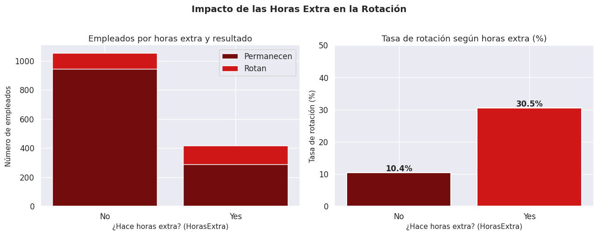
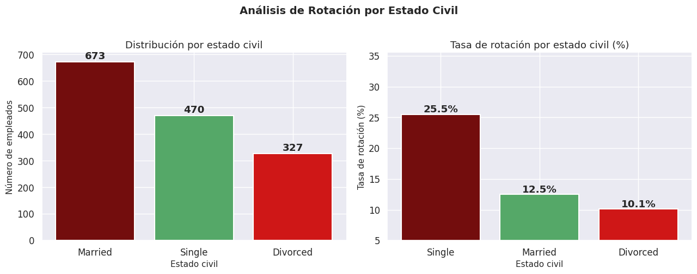
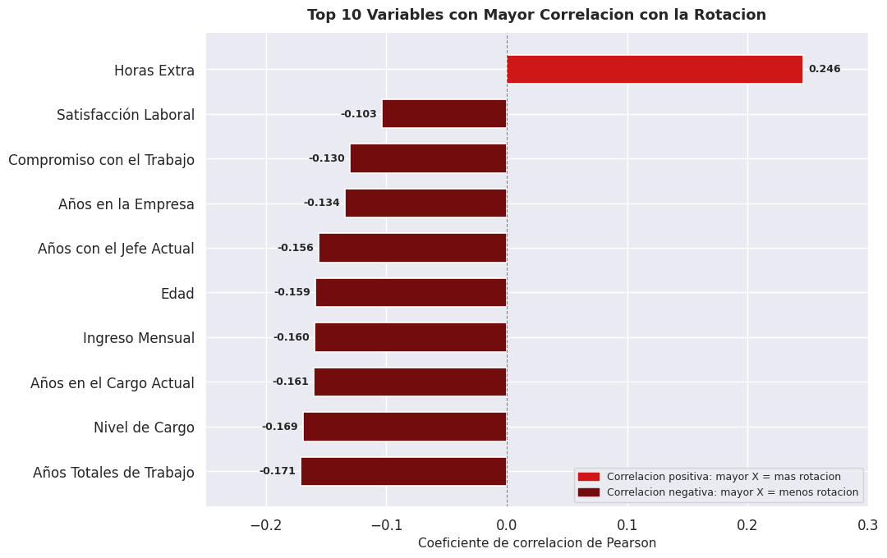
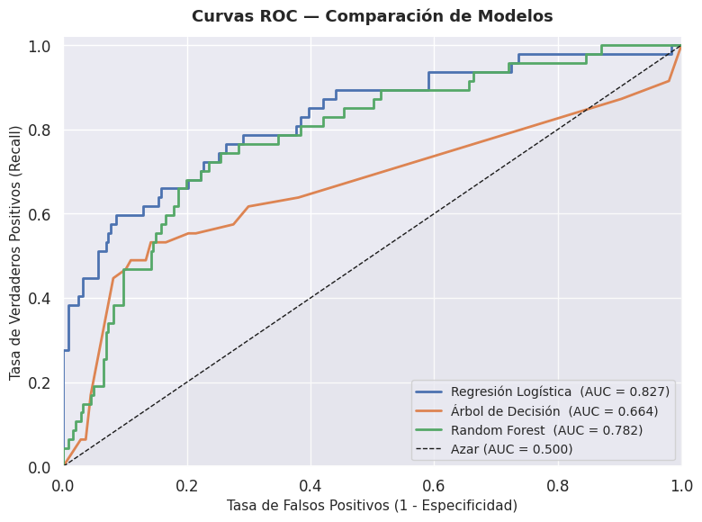
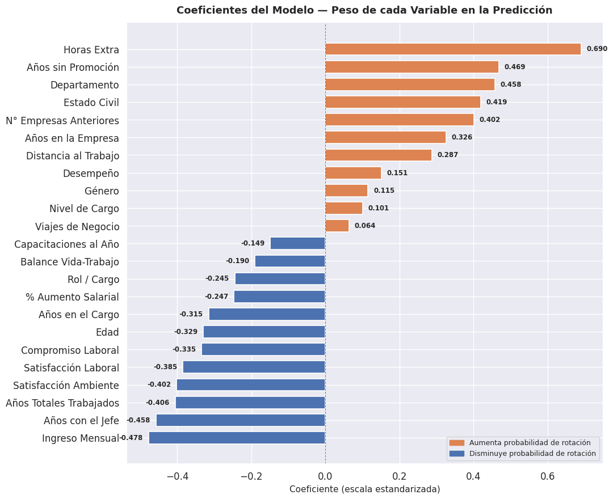

# Retención de talento en IBM: análisis de rotación de empleados

Proyecto final del **Bootcamp 702 de Análisis de Datos** (Talento Tech · MinTIC · Universidad de Caldas, nivel exploratorio).
Análisis exploratorio, estadístico y predictivo de la rotación de empleados con el dataset público **IBM HR Analytics**.

> 👥 **Proyecto grupal de 4 integrantes.** Mi rol en el equipo: **Análisis**.

## 🎯 Pregunta de investigación
¿Qué factores demográficos (género, estado civil), laborales (departamento, horas extra, nivel salarial) y de satisfacción se asocian con mayor probabilidad de rotación de los empleados, y cuáles tienen la relación más fuerte según el departamento?

**Valor para el negocio:** pasar de reaccionar cuando el empleado ya renunció a identificar con anticipación a quienes están en riesgo de salir, para reducir los costos de reemplazo.

## 📊 Datos
| | |
|---|---|
| Fuente | IBM HR Analytics Employee Attrition & Performance (IBM Watson Analytics / Kaggle), dataset público con fines educativos |
| Tamaño | 1.470 empleados · 35 variables |
| Variable objetivo | Rotación (Yes = salió / No = permanece) |
| Calidad | Sin valores nulos ni filas duplicadas; se eliminaron columnas constantes sin variabilidad |
| Desbalance | 83,9 % permanece · 16,1 % rota (237 empleados) |

El archivo `data/recursos_humanos_ibm.csv` es la versión con nombres de columnas en español usada en el proyecto.

## ⚙️ Metodología (CRISP-DM)
1. **Comprensión del negocio y de los datos:** pregunta, objetivo y variable objetivo.
2. **Limpieza y preparación:** revisión de nulos y duplicados, eliminación de columnas constantes, análisis de valores atípicos (se conservaron por ser válidos), variables derivadas y codificación.
3. **Análisis descriptivo:** tasas de rotación por variables demográficas, laborales y de satisfacción.
4. **Correlaciones y segmentación por departamento.**
5. **Pruebas estadísticas:** t-test, ANOVA y chi-cuadrado.
6. **Modelado predictivo:** Regresión Logística, Árbol de decisión y Random Forest, con `class_weight="balanced"` para el desbalance, estandarización y PCA. División 80/20 estratificada.
7. **Evaluación:** Accuracy, precisión, recall, F1 y AUC-ROC.

## 🔎 Hallazgos principales
**Horas extra: el factor con mayor asociación.** Los empleados con horas extra rotan **30,5 %** frente a **10,4 %** de quienes no las hacen, casi 3 veces más. Es la correlación más alta con la rotación (r = +0,246) y el coeficiente más fuerte del modelo.

**Estado civil.** Los solteros rotan **25,5 %**, frente a 12,5 % de los casados y 10,1 % de los divorciados (diferencia significativa, chi-cuadrado p < 0,0001).

**Otros hallazgos**
- **Ingreso:** la mediana de quienes rotan es **$3.202**, frente a **$5.204** de quienes permanecen. Es el factor protector más fuerte del modelo.
- **Departamento:** Sales (20,6 %) y Recursos Humanos (19,0 %) rotan más que R&D (13,8 %). Las horas extra elevan la rotación en los tres departamentos.
- **Edad y antigüedad:** quienes rotan son más jóvenes (33,6 años en promedio frente a 37,6) y la mediana de antigüedad de quienes rotan es de 3 años. Los primeros años son el periodo crítico.
- **Género:** la diferencia (14,8 % mujeres, 17,0 % hombres) no es estadísticamente significativa (p = 0,29).
- **Desempeño:** la evaluación de rendimiento no diferencia a quienes rotan de quienes permanecen.

## 🤖 Modelo predictivo
| Modelo | Accuracy | Precisión | Recall | F1 | AUC-ROC |
|---|---|---|---|---|---|
| **Regresión Logística** | 0,745 | 0,354 | **0,723** | 0,476 | **0,827** |
| Árbol de decisión | 0,687 | 0,282 | 0,617 | 0,387 | 0,664 |
| Random Forest | 0,816 | 0,360 | 0,191 | 0,250 | 0,782 |

La **Regresión Logística** fue el modelo recomendado: tiene el mejor AUC-ROC y el mejor recall, es decir, detecta a 7 de cada 10 empleados que realmente rotan. Random Forest tiene mayor accuracy, pero un recall muy bajo, que lo hace poco útil cuando el objetivo es detectar la rotación.

## ⚠️ Limitaciones
- El dataset no distingue rotación voluntaria de involuntaria.
- Es una foto en un momento dado, sin fecha de corte, por lo que no permite ver tendencias en el tiempo.
- Los modelos son de nivel exploratorio: sin validación cruzada ni optimización de hiperparámetros, así que las métricas pueden ser optimistas.
- Con el desbalance de clases, el accuracy es engañoso; se priorizaron recall y AUC-ROC.
- El análisis es correlacional: no establece causalidad.

## 🤝 Consideraciones éticas
El modelo debe apoyar la decisión de Recursos Humanos, no reemplazarla. Sus predicciones no deben usarse para discriminar en ascensos, evaluaciones o despidos, y conviene auditarlo periódicamente para detectar sesgos por género, edad o estado civil.

## 📁 Estructura
| Ruta | Contenido |
|---|---|
| `notebooks/01_Analisis_Rotacion_IBM.ipynb` | Análisis completo: limpieza, estadística, correlaciones, segmentación y modelos |
| `notebooks/02_Dashboard_Interactivo.ipynb` | Dashboard interactivo de EDA con ipywidgets y Plotly (se ejecuta en Colab) |
| `data/` | Dataset en español |
| `images/` | Gráficos usados en este README |

## ▶️ Cómo ejecutarlo
Los notebooks se desarrollaron en **Google Colab** y leen el CSV desde Google Drive. Para ejecutarlos: ábrelos en Colab, sube `data/recursos_humanos_ibm.csv` a tu Drive y ajusta la ruta en la celda de carga del dataset.

## 🧰 Herramientas
Python · pandas · NumPy · Matplotlib · Seaborn · SciPy · statsmodels · scikit-learn · Plotly · ipywidgets · Google Colab
